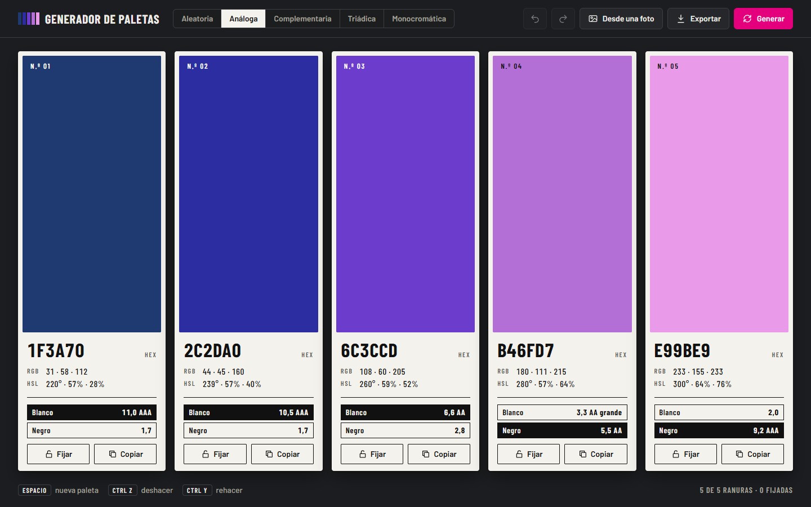

# 1. Generador de paletas

La barra espaciadora genera cinco colores que combinan. Puedes fijar los que te gustan, revisar su contraste, copiarlos, exportarlos como variables CSS o sacar una paleta de una foto tuya.

- **Nivel:** Fácil
- **Guía paso a paso:** [domina-js.pages.dev/proyectos/generador-de-paletas](https://domina-js.pages.dev/proyectos/generador-de-paletas)
- **Demo:** [pruébalo en el navegador](https://domina-js-proyectos.pages.dev/01-generador-de-paletas/final/)

## Qué vas a usar

Conversión de colores (hex, RGB y HSL), el contraste de la WCAG, eventos de teclado, delegación de eventos, arrays como pila para deshacer, `navigator.clipboard`, `URLSearchParams` e `history.replaceState`, `<dialog>`, `<canvas>` con `getImageData`, arrastrar y soltar archivos y la Web Animations API.

## Cómo abrirlo

No necesita instalar nada: abre `index.html` con doble clic en tu navegador.

## Carpetas

- `inicial/`: el punto de partida para seguir la guía.
- `final/`: el proyecto terminado.

## Créditos

- Fuentes: [Barlow](https://github.com/jpt/barlow), de Jeremy Tribby, con licencia SIL Open Font License 1.1 (ver `final/fuentes/OFL.txt`).
