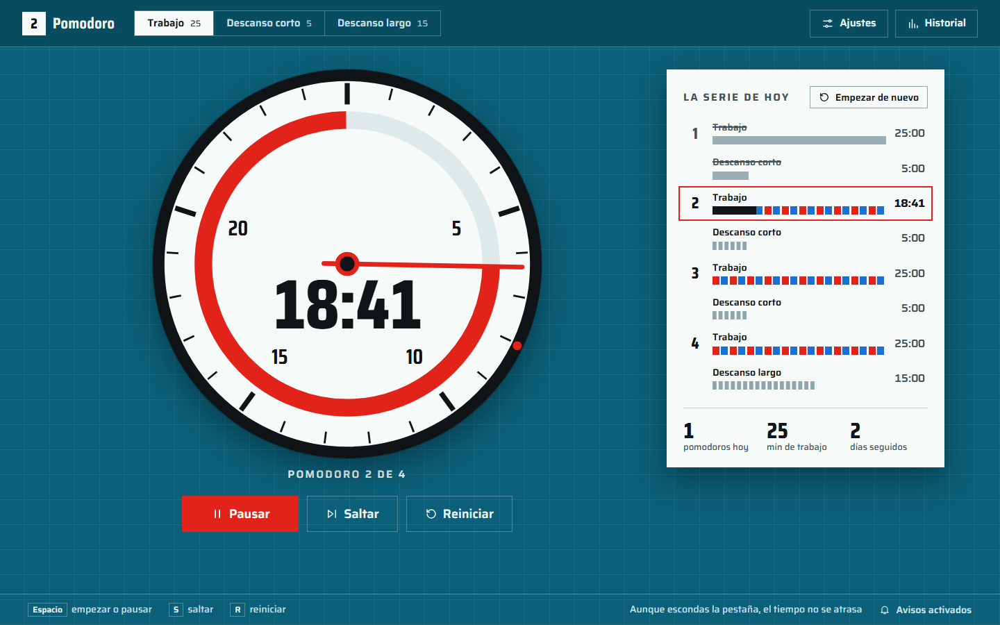

# 2. Temporizador Pomodoro

Bloques de trabajo y descanso que no se atrasan aunque escondas la pestaña. Al terminar cada uno suena un pitido y llega un aviso, la pantalla no se apaga mientras corre, y si recargas la página el reloj sigue donde iba.

- **Nivel:** Fácil
- **Guía paso a paso:** [domina-js.pages.dev/proyectos/pomodoro](https://domina-js.pages.dev/proyectos/pomodoro)
- **Demo:** [pruébalo en el navegador](https://domina-js-proyectos.pages.dev/02-pomodoro/final/)

## Qué vas a usar

Timers (`setInterval` y `setTimeout`) y por qué se atrasan, el event loop, `Date.now()`, la API de visibilidad de la página, notificaciones, Wake Lock, vibración, un pitido con Web Audio, `document.title`, SVG creado desde JavaScript, `localStorage`, `<dialog>` y `Intl.DateTimeFormat`.

## Cómo abrirlo

No necesita instalar nada: abre `index.html` con doble clic en tu navegador.

## Carpetas

- `inicial/`: el punto de partida para seguir la guía.
- `final/`: el proyecto terminado.

## Créditos

- Fuente: [Saira](https://github.com/Omnibus-Type/Saira), de Omnibus-Type, con licencia SIL Open Font License 1.1 (ver `final/fuentes/OFL.txt`).
