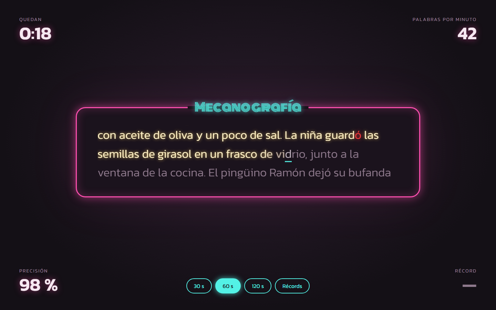

# 3. Reto de mecanografía

Escribe un texto en español contra reloj: 30, 60 o 120 segundos. Cada letra bien escrita se enciende y cada error parpadea en rojo. Las tildes, la ñ, la ü y los signos ¿ y ¡ se cuentan bien aunque el teclado los mande en dos partes. Al terminar ves tus palabras por minuto, tu precisión, una gráfica de tu ritmo y las letras que más fallaste, y tus récords quedan guardados.

- **Nivel:** Fácil
- **Guía paso a paso:** [domina-js.pages.dev/proyectos/mecanografia](https://domina-js.pages.dev/proyectos/mecanografia)
- **Demo:** [pruébalo en el navegador](https://domina-js-proyectos.pages.dev/03-mecanografia/final/)

## Qué vas a usar

Texto y Unicode (`normalize` e `Intl.Segmenter`), expresiones regulares con clases Unicode (`\p{M}`), los eventos `input`, `compositionend` y `keydown`, `getModifierState`, `performance.now()` y `requestAnimationFrame`, `Map`, SVG creado desde JavaScript, `aria-live`, `localStorage`, `<dialog>` e `Intl.NumberFormat`.

## Cómo abrirlo

No necesita instalar nada: abre `index.html` con doble clic en tu navegador.

## Carpetas

- `inicial/`: el punto de partida para seguir la guía.
- `final/`: el proyecto terminado.

## Créditos

- Fuentes: [Kanit](https://github.com/cadsondemak/kanit), de Cadson Demak, y [Monoton](https://fonts.google.com/specimen/Monoton), de Vernon Adams, las dos con licencia SIL Open Font License 1.1 (ver `final/fuentes/OFL.txt`).
