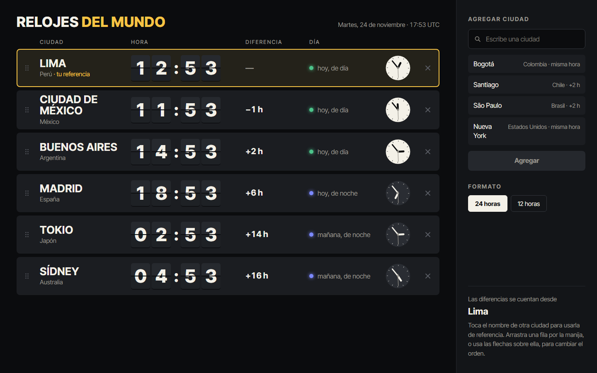

# 4. Relojes del mundo

La hora de las ciudades que elijas, en un tablero de salidas. Cada ciudad es una fila con su hora en paletas que giran cuando cambia el minuto, cuánto se adelanta o se atrasa respecto de la tuya, si allá es de día o de noche, si es hoy, ayer o mañana, y un reloj analógico chico. Agregas ciudades buscándolas, eliges cuál es tu referencia y las ordenas arrastrándolas o con el teclado. Todo queda guardado.

- **Nivel:** Fácil
- **Guía paso a paso:** [domina-js.pages.dev/proyectos/relojes-del-mundo](https://domina-js.pages.dev/proyectos/relojes-del-mundo)
- **Demo:** [pruébalo en el navegador](https://domina-js-proyectos.pages.dev/04-relojes-del-mundo/final/)

## Qué vas a usar

Temporal, con un plan B en `Date` e `Intl.DateTimeFormat` para los navegadores que todavía no lo tienen; `Intl.supportedValuesOf` e `Intl.DisplayNames`; `<template>`; SVG con agujas que giran; `requestAnimationFrame`; `animate()` y sus promesas; arrastrar y soltar, y una alternativa con el teclado; delegación de eventos y `localStorage`.

## Cómo abrirlo

No necesita instalar nada: abre `index.html` con doble clic en tu navegador.

## Carpetas

- `inicial/`: el punto de partida para seguir la guía.
- `final/`: el proyecto terminado.

## Créditos

- Fuente: [Inter Tight](https://github.com/rsms/inter), de Rasmus Andersson, con licencia SIL Open Font License 1.1 (ver `final/fuentes/OFL.txt`).
