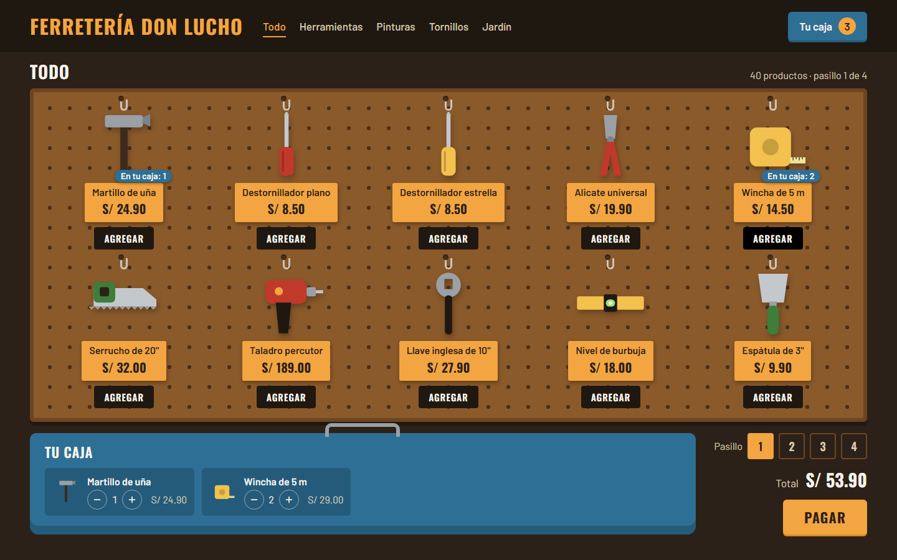

# 5. Tienda pequeña

Una tienda de barrio en el navegador: la Ferretería Don Lucho. Cuarenta productos en cuatro secciones, diez por pasillo, con la sección y el pasillo en la dirección de la página para que el botón Atrás funcione. Cada producto se puede ver de cerca en una vista rápida y agregar a la caja, cuyo número sube sin recargar, también en otra pestaña. La caja permite cambiar las cantidades y termina en un pago de prueba, con «Procesando…» y «¡Pago confirmado!».

- **Nivel:** Intermedio
- **Guía paso a paso:** [domina-js.pages.dev/proyectos/tienda-pequena](https://domina-js.pages.dev/proyectos/tienda-pequena)
- **Demo:** [pruébalo en el navegador](https://domina-js-proyectos.pages.dev/05-tienda-pequena/final/)

## Qué vas a usar

Clases con campos y métodos privados (el carrito extiende `EventTarget`), eventos propios con `CustomEvent`, `Map`, `URLSearchParams` e `history.pushState` con el evento `popstate`, `Intl.NumberFormat`, `<template>`, la Popover API, `<dialog>`, formularios con la validación del navegador y mensajes propios, `localStorage` y el evento `storage`, promesas con `async` y `await`, y `aria-live`.

## Cómo abrirlo

No necesita instalar nada: abre `index.html` con doble clic en tu navegador.

## Carpetas

- `inicial/`: el punto de partida para seguir la guía.
- `final/`: el proyecto terminado.

## Créditos

- Fuentes: [Oswald](https://github.com/googlefonts/OswaldFont), de Vernon Adams, y [Barlow](https://github.com/jpt/barlow), de Jeremy Tribby, las dos con licencia SIL Open Font License 1.1 (ver `final/fuentes/OFL.txt`).
