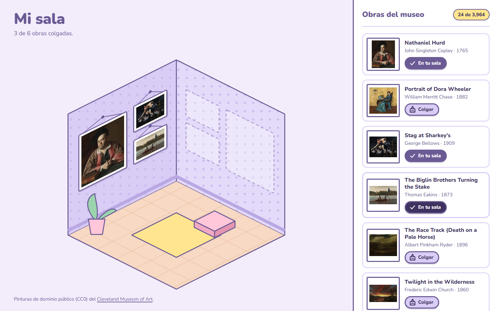

# 6. Explorador con scroll infinito

Un explorador de las pinturas de dominio público del Cleveland Museum of Art. La lista se alarga sola al llegar al final, de 12 en 12, y cada obra tiene su ficha con la imagen grande, la fecha, la técnica y su historia. Las que más te gusten se cuelgan en tu propia sala, una sala en miniatura con seis lugares que queda guardada para la próxima visita. Si el museo no responde, la lista avisa y deja reintentar.

- **Nivel:** Intermedio
- **Guía paso a paso:** [domina-js.pages.dev/proyectos/explorador-de-arte](https://domina-js.pages.dev/proyectos/explorador-de-arte)
- **Demo:** [pruébalo en el navegador](https://domina-js-proyectos.pages.dev/06-explorador-de-arte/final/)

## Qué vas a usar

`fetch` con `URLSearchParams` y `AbortSignal.timeout`, `async` y `await`, `IntersectionObserver` para el scroll infinito, `<template>` y `cloneNode`, imágenes con carga diferida (`loading="lazy"`), una caché con `Map`, errores con reintento, `<dialog>` con `showModal`, delegación de eventos, SVG creado con `createElementNS`, Web Animations (`animate`) con `prefers-reduced-motion`, `localStorage` y `Promise.allSettled`.

## Cómo abrirlo

No necesita instalar nada: abre `index.html` con doble clic en tu navegador. Sí necesita conexión a internet, porque las obras llegan de la API del museo.

## Carpetas

- `inicial/`: el punto de partida para seguir la guía.
- `final/`: el proyecto terminado.

## Créditos

- Obras: [Cleveland Museum of Art Open Access](https://www.clevelandart.org/open-access). Las imágenes y los datos son de dominio público (CC0).
- Fuente: [Nunito](https://github.com/googlefonts/nunito), de Vernon Adams, con licencia SIL Open Font License 1.1 (ver `final/fuentes/OFL.txt`).
