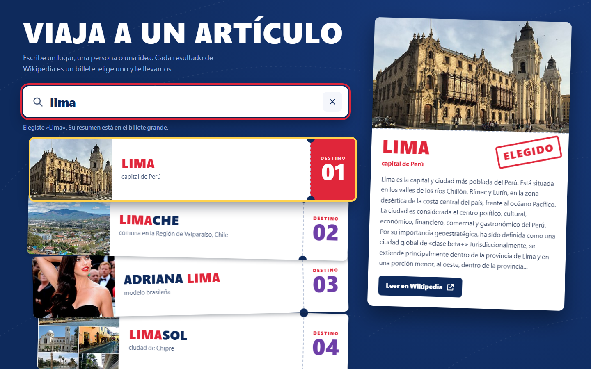

# 7. Buscador con autocompletado

Un buscador de Wikipedia en español que sugiere mientras escribes. Cada resultado es un billete de avión con la foto de su artículo y lo que coincide resaltado en rojo, aunque escribas sin tildes. Se recorre con las flechas, como un combobox accesible de verdad, y el billete elegido trae el resumen del artículo con su foto y un enlace para leerlo completo. Espera a que dejes de escribir, cancela las búsquedas viejas y recuerda las que ya hiciste.

- **Nivel:** Intermedio
- **Guía paso a paso:** [domina-js.pages.dev/proyectos/autocompletado](https://domina-js.pages.dev/proyectos/autocompletado)
- **Demo:** [pruébalo en el navegador](https://domina-js-proyectos.pages.dev/07-autocompletado/final/)

## Qué vas a usar

Debounce con closures, `fetch` con `URLSearchParams`, `AbortController` y `AbortSignal.any` para cancelar lo viejo, una caché con `Map`, `normalize('NFD')` y `\p{M}` para comparar sin tildes, `RegExp.escape` (ES2025) y `matchAll`, `<template>`, el patrón combobox con `aria-activedescendant` y `aria-expanded`, `role="status"` y errores con reintento.

## Cómo abrirlo

No necesita instalar nada: abre `index.html` con doble clic en tu navegador. Sí necesita conexión a internet, porque los resultados llegan de Wikipedia.

## Carpetas

- `inicial/`: el punto de partida para seguir la guía.
- `final/`: el proyecto terminado.

## Créditos

- Textos y fotos: [Wikipedia en español](https://es.wikipedia.org) y Wikimedia Commons, cada uno con su licencia (la de los textos es CC BY-SA).
- Fuente: [Archivo](https://github.com/Omnibus-Type/Archivo), de Omnibus-Type, con licencia SIL Open Font License 1.1 (ver `final/fuentes/OFL.txt`).
