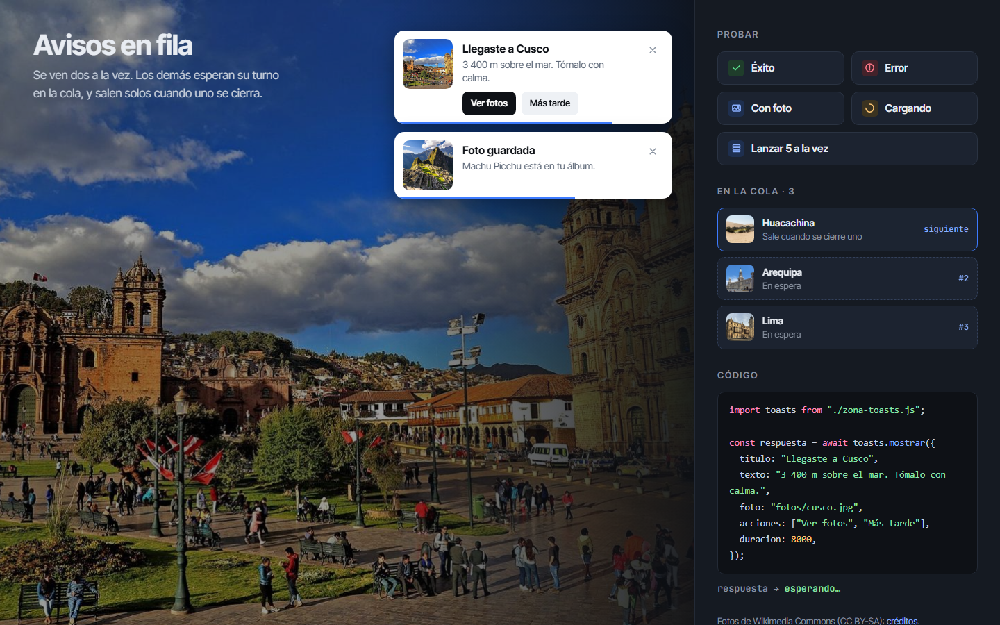

# 8. Notificaciones toast

Una librería propia de avisos, `zona-toasts`, pensada para reutilizar en otros proyectos. Es un Web Component con Shadow DOM: se importa como módulo y se usa con una línea, `await toasts.mostrar({...})`, que termina cuando la persona cierra el aviso o elige una acción. Se ven dos avisos a la vez y los demás esperan en una cola, que la demo muestra a la vista. Cada aviso se cierra solo con el tiempo (que se pausa si lo estás mirando), con la X, con Escape o deslizándolo, y uno de «cargando» cambia solo a éxito o a error cuando termina su tarea.

- **Nivel:** Intermedio
- **Guía paso a paso:** [domina-js.pages.dev/proyectos/notificaciones-toast](https://domina-js.pages.dev/proyectos/notificaciones-toast)
- **Demo:** [pruébalo en el navegador](https://domina-js-proyectos.pages.dev/08-notificaciones-toast/final/)

## Qué vas a usar

Módulos de JavaScript (`export`, `import`, `import * as`, `import.meta.url`), Web Components (`customElements.define`, `connectedCallback`) y Shadow DOM, campos privados, eventos propios con `CustomEvent`, `Promise.withResolvers` (ES2024) y una cola con promesas, Web Animations (`animate`, `finished`, `pause` y `play`) con `prefers-reduced-motion`, Pointer Events con `setPointerCapture`, template tags para escapar el HTML, `role="status"` y `role="alert"`.

## Cómo abrirlo

**No lo abras con doble clic.** El proyecto usa módulos (`import` y `export`), y el navegador no los carga desde un archivo abierto así (`file://`): la página queda sin avisos y la consola muestra un error de CORS.

Ábrelo con un servidor local. Lo más simple es **VS Code con la extensión Live Server**: instálala, haz clic derecho en `index.html` y elige «Open with Live Server». Si prefieres la terminal, `npx serve` dentro de la carpeta también sirve.

## Carpetas

- `inicial/`: el punto de partida para seguir la guía.
- `final/`: el proyecto terminado.

## Créditos

- Fotos: Wikimedia Commons, con licencia CC BY-SA (autores y enlaces en `final/fotos/CREDITOS.md`).
- Fuentes: [Inter Tight](https://github.com/rsms/inter) y [JetBrains Mono](https://github.com/JetBrains/JetBrainsMono), con licencia SIL Open Font License 1.1 (ver `final/fuentes/OFL.txt`).
